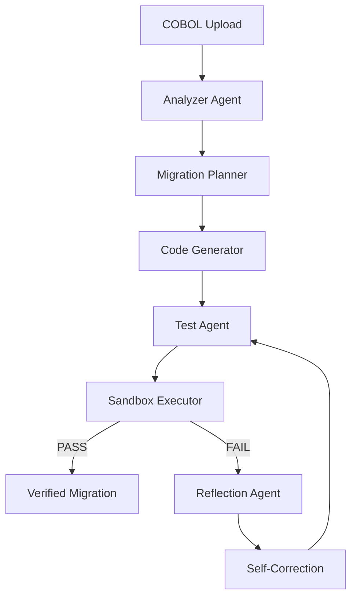

# Project Retrofit
## Autonomous Legacy Code Modernization Agent

Project Retrofit converts uploaded legacy COBOL into modern Python, generates regression tests, executes the migration in a temporary sandbox, detects behavioral failures, performs reflection/self-correction, and verifies the repaired implementation.

## Architecture



## Agents

| Agent | Responsibility |
|---|---|
| Analyzer | Extracts variables, business rules, calculations, conditions and risks |
| Planner | Creates target architecture and migration strategy |
| Generator | Produces modern Python |
| Test Agent | Creates regression tests |
| Sandbox Executor | Runs generated code and pytest |
| Reflection | Diagnoses failures |
| Self-Correction | Repairs the implementation and triggers re-verification |

## Technology

- Python 3.12+
- Streamlit
- LangGraph
- Google Gemini API
- Pydantic
- pytest
- Decimal

## Local Setup

```bash
cd project-retrofit
python3.12 -m venv .venv
source .venv/bin/activate
pip install -r requirements.txt
```

Create `.env`:

```env
GEMINI_API_KEY=YOUR_GOOGLE_AI_STUDIO_API_KEY
GEMINI_MODEL=gemini-2.5-flash
```

Run:

```bash
python -m streamlit run app.py
```

Open the Streamlit URL, normally `http://localhost:8501`.

## Official Benchmark

Upload `PAYROLL-CALC.CBL`.

The system preserves the payroll rules including:

- hourly rate = base salary / 40
- hours above 40 receive 1.5x overtime
- tax tier 1 = 10%
- tax tier 2 = 20%
- tax tier 3 = 30%
- other tiers = 35%
- gross pay, tax deduction and net pay
- Decimal precision for financial calculations

## Execution Flow

```text
COBOL
  ↓
Analyze
  ↓
Plan
  ↓
Generate Python
  ↓
Generate Tests
  ↓
Sandbox Execute
  ↓
FAIL → Reflect → Repair → Re-test
  ↓
PASS
```

## Security

Uploaded COBOL is treated as text and is not directly executed. Generated Python is executed in a temporary directory through a subprocess with a timeout.

For production, replace the subprocess with a hardened Docker sandbox using non-root execution, disabled network access, CPU/memory/process limits, read-only filesystem, syscall restrictions and ephemeral storage.

## Limitations

The prototype demonstrates behavioral equivalence against a regression suite; it is not a formal proof of equivalence for every possible input.

Future production improvements include Docker isolation, differential testing against a COBOL runtime, AST-level parsing, human approval, rollback, REST APIs, security scanning and cost/token telemetry.

## Demo

1. Start Streamlit.
2. Upload `PAYROLL-CALC.CBL`.
3. Click **START MIGRATION**.
4. Show Analysis and Migration Plan.
5. Show generated Python using Pydantic and Decimal.
6. Show the intentional first-pass failure.
7. Show Reflection and Self-Correction.
8. Show final `PASS`.

## Project Structure

```text
project-retrofit/
├── app.py
├── README.md
├── ARCHITECTURE.md
├── requirements.txt
├── benchmark/
├── tests/
├── generated/
└── app/
```
